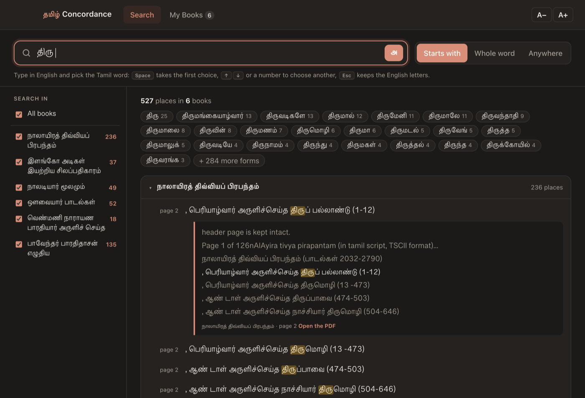
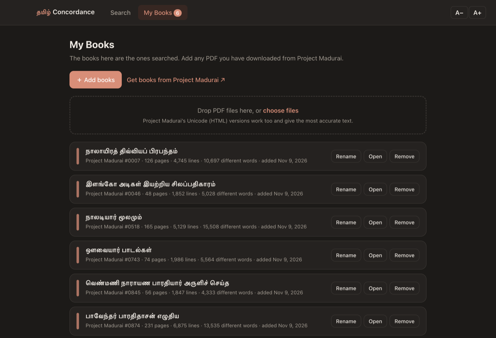
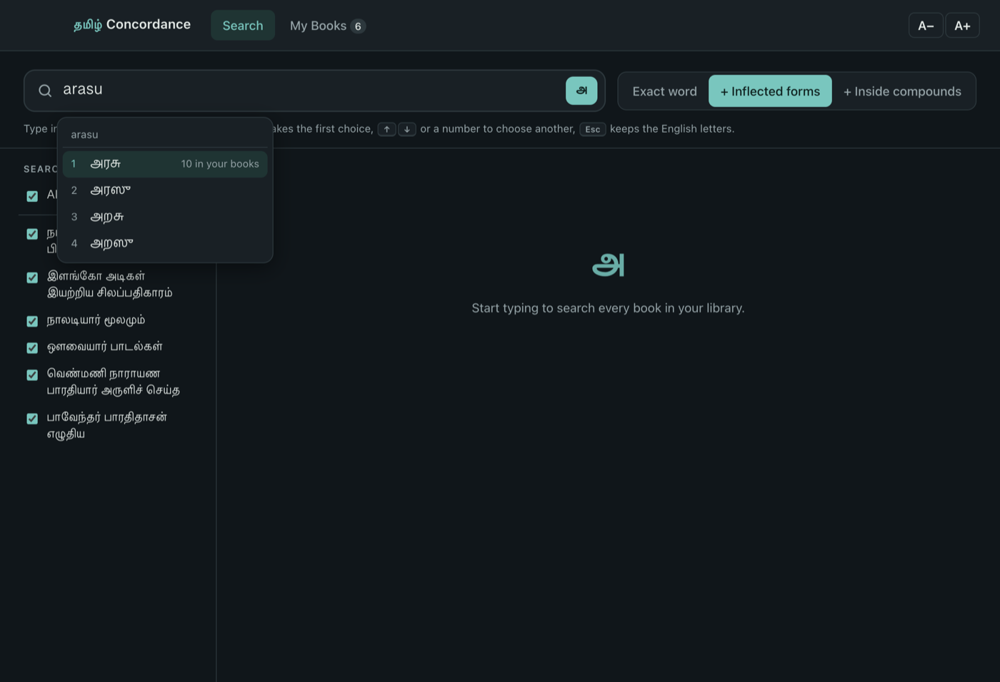

# தமிழ் Concordance

A personal Tamil concordance for the books of [Project Madurai](https://www.projectmadurai.org/).
Add the PDFs you've downloaded, then find every place a word appears in them. You can type
in Tamil, or type in English letters and pick the Tamil word from a dropdown, the way Google Input Tools works.

Each person's copy holds their own library, so it only searches the books they've added.



## Features

- **Your own library.** Add Project Madurai PDFs by dragging them in or with **Add books**. They're
  remembered between sessions, and the **My Books** tab lists every book with its page, line and word counts.
- **Type in English, get Tamil.** Type `aRam`, `thiruvaLLuvar` or `kaathal` and choose from several
  spellings. Each suggestion shows how often it appears in *your* books, and words from your books
  rank higher. Google's suggestions are added when you're online. Without internet, the app's own
  transliterator still works.
- **Concordance search.** Three match levels, each with its count: *Exact word*; *+ Inflected forms*
  (அரசு also finds அரசன், அரசர்க்கு; நிலம் finds நிலத்தில்); and *+ Inside compounds* (தாமரை in
  செந்தாமரைக்). Bars show how often the word occurs in each book. A row of chips lists every word form
  found, with counts. Results are grouped by book with page and verse numbers ("p. 72 · no. 13").
  Click a line to see the lines around it, or open the original PDF.
- **Handles every Project Madurai PDF style tested:** old TSCII-font PDFs (Windows- or Mac-made)
  and newer "Unicode" PDFs whose text layer is scrambled. See [How it works](docs/HOW_IT_WORKS.md).
  Project Madurai's Unicode **HTML** pages can be added too.
- **Built for comfortable reading.** Large Tamil type with **A− / A+** text size. It follows the computer's
  light or dark mode and works fully offline (apart from the optional Google suggestions).

| My Books | Typing in English |
|---|---|
|  |  |

## Download & install (Mac)

1. From the [latest release](https://github.com/sarvesh-venkittu/tamil-concordance/releases/latest),
   download the right file for the Mac. To check which one it is, open  menu → **About This Mac**:
   - **Chip: Apple M1/M2/M3/M4…** → `Tamil-Concordance-<version>-arm64.dmg`
   - **Processor: Intel…** → `Tamil-Concordance-<version>-x64.dmg`
2. Open the `.dmg` and drag **Tamil Concordance** into **Applications**.
3. The first time only: the app isn't from the App Store, so macOS will warn you.
   - **macOS 15 (Sequoia) or newer:** open the app once and click **Done** on the warning. Then go to
     **System Settings → Privacy & Security**, scroll down, click **Open Anyway** next to
     *"Tamil Concordance" was blocked*, and confirm.
   - **macOS 14 or older:** right-click (or Control-click) the app in Applications, choose **Open**,
     then click **Open** again.

If the app only bounces in the Dock and never opens (likely when the DMG was sent by email or
AirDrop), quit it and run `xattr -cr "/Applications/Tamil Concordance.app"` in Terminal, then open it again.

After that it opens normally. There is a simple step-by-step guide for non-technical users in
[docs/USER_GUIDE.md](docs/USER_GUIDE.md).

## Using it

1. Download books from [Project Madurai](https://www.projectmadurai.org/pmworks.html) (the PDF link of any work).
2. In **My Books**, click **＋ Add books** or drop the files in. Reading takes a few seconds per book.
3. In **Search**, start typing:

| Key | Does |
|---|---|
| letters | build the word in English; suggestions appear |
| <kbd>Space</kbd> / <kbd>Enter</kbd> | take the highlighted Tamil word (and search) |
| <kbd>↑</kbd> <kbd>↓</kbd> or <kbd>1</kbd>–<kbd>7</kbd> | choose another suggestion |
| <kbd>Esc</kbd> | keep the English letters as typed |
| <kbd>Ctrl</kbd>+<kbd>G</kbd> or the **அ** button | switch English-to-Tamil typing on/off |
| <kbd>⌘</kbd>+<kbd>O</kbd> | add books |
| <kbd>⌘</kbd>+<kbd>=</kbd> / <kbd>⌘</kbd>+<kbd>-</kbd> | larger / smaller text |

Capital letters spell out the harder sounds: `L` ள, `N` ண, `R` ற, `zh` ழ, `A`/`aa` ஆ, `I`/`ee` ஈ,
`U`/`oo` ஊ, `E` ஏ, `O` ஓ.

## History

This started as a single-page web concordance of four texts (Nalayira Divya Prabandham,
Silappathikaram, Avvaiyar and Thiruvenkata Satakam). This app keeps that version's matching
rules and look. It adds a personal library you can add PDFs to, decoders for Project Madurai PDFs,
and English-letters typing. The four texts from the web version served as a check on the decoders.

## Privacy

Your books and searches stay on your computer. The library is kept in
`~/Library/Application Support/Tamil Concordance/library/`. The only network request is the optional
Google suggestion lookup: the English letters of the word you're typing go to `inputtools.google.com`.
You can turn this off in **My Books → Also show Google's suggestions**.

## Building from source

Requires [Node.js](https://nodejs.org/) 20 or newer.

```bash
git clone https://github.com/sarvesh-venkittu/tamil-concordance.git
cd tamil-concordance
npm install
npm start            # run the app
npm test             # unit tests (decoding, transliteration, search)
npm run dist:mac     # build dist/Tamil-Concordance-<version>-arm64.dmg and -x64.dmg
npm run dist:mac-universal   # one DMG for both (needs Xcode Command Line Tools for lipo)
npm run dist:win     # build a Windows installer (untested)
```

**Smoke test with real PDFs:** put some Project Madurai PDFs in a folder, then run
`TC_SMOKE=/path/to/folder npm start`. The app adds them to a throwaway library, types a search
(`TC_SMOKE_WORD`, default `aRam`), saves screenshots into that folder and quits.

## Project layout

```
app/
  main.js            Electron main process: window, menus, library storage, Google lookup
  preload.cjs        the small, fixed API the page is allowed to call
  extract-worker.js  reads one PDF/HTML file in a worker thread
  lib/
    extract.js       pdf.js text → lines, titles, statistics
    tamilfix.js      decoders for TSCII and broken-Unicode Tamil PDFs
  renderer/
    index.html, styles.css, app.js   the interface
    translit.js      offline English-letters → Tamil suggestions
    search.js        in-memory concordance index
build/               app icons
docs/                user guide, technical notes, screenshots
test/                unit tests (node --test)
```

## Known limits

- The app is not notarised by Apple, so the first launch needs the one-time step above.
- Text extraction was tested on six Project Madurai PDFs (pm0007, 0046, 0518, 0743, 0845, 0874).
  A PDF made with a font not seen yet may come out partly garbled. The **My Books** card then shows a
  warning; use the Unicode HTML version of that work instead, and please
  [open an issue](https://github.com/sarvesh-venkittu/tamil-concordance/issues) with the PM number.
- Page numbers are PDF page numbers. For HTML books, a "page" is a block of 40 lines.

## License

[MIT](LICENSE). Project Madurai texts belong to Project Madurai and its volunteers; this app
only reads files you've downloaded yourself.
